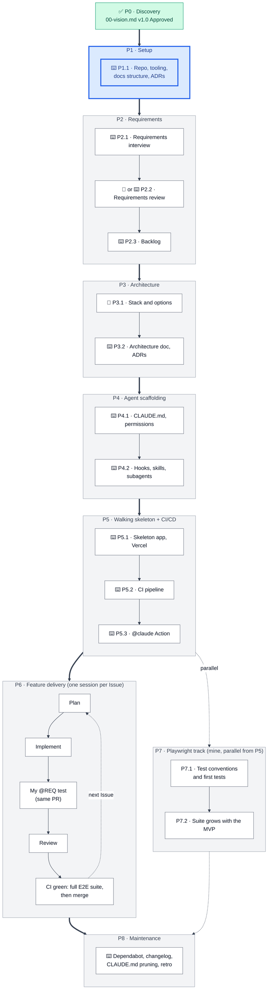

# FitCadence – Delivery roadmap

**Where I am now:** discovery (P0) is complete, vision v1.0 Approved · **Next:** `P1.1 · Setup` in Claude Code

This file covers P1 to P8. Discovery (P0) is in `fitcadence-discovery-roadmap.md` (frozen). The phase map and IDs come from `fitcadence-project-brief.md` §6. Sub-phases and steps that the brief does not list are marked **[ASSUMPTION]** and are confirmed when the phase starts.

## Map

💬 = Claude.ai chat in the FitCadence Project. ⌨️ = Claude Code session. Context moves between them only through documents and handoff blocks. P7 runs in parallel from P5.

**Legend:** green = done · blue (thick border) = next/current · grey = upcoming · white box = stage

## Status tracker

| Phase                       | Stage                                                        | Where              | Status   | Output                          | Version |
| --------------------------- | ------------------------------------------------------------ | ------------------ | -------- | ------------------------------- | ------- |
| P1 Setup                    | P1.1 Repo, tooling, docs structure, ADRs                     | ⌨️                 | ▶️ Next  | Repo skeleton, ADRs             | –       |
| P2 Requirements             | P2.1 Requirements interview                                  | ⌨️                 | ⏳ To do | `01-requirements.md`            | –       |
|                             | P2.2 Requirements review                                     | 💬 or ⌨️           | ⏳ To do | Approved REQs                   | –       |
|                             | P2.3 Backlog                                                 | ⌨️                 | ⏳ To do | Issues, milestones, board       | –       |
| P3 Architecture             | P3.1 Stack and options                                       | 💬                 | ⏳ To do | Option comparison, D-08 decided | –       |
|                             | P3.2 Architecture doc, ADRs                                  | ⌨️                 | ⏳ To do | `02-architecture.md`, ADRs      | –       |
| P4 Agent scaffolding        | P4.1 CLAUDE.md, permissions **[ASSUMPTION: sub-phase]**      | ⌨️                 | ⏳ To do | `CLAUDE.md`, `.claude/settings` | –       |
|                             | P4.2 Hooks, skills, subagents **[ASSUMPTION: sub-phase]**    | ⌨️                 | ⏳ To do | `.claude/`                      | –       |
| P5 Walking skeleton + CI/CD | P5.1 Skeleton app, Vercel **[ASSUMPTION: sub-phase]**        | ⌨️                 | ⏳ To do | Live demo URL                   | –       |
|                             | P5.2 CI pipeline **[ASSUMPTION: sub-phase]**                 | ⌨️                 | ⏳ To do | Green GitHub Actions run        | –       |
|                             | P5.3 `@claude` Action **[ASSUMPTION: sub-phase]**            | ⌨️                 | ⏳ To do | Comment-triggered workflow      | –       |
| P6 Feature delivery         | One session per Issue                                        | ⌨️                 | ⏳ To do | Merged PRs                      | –       |
| P7 Playwright track         | P7.1 Conventions and first tests **[ASSUMPTION: sub-phase]** | VS Code + ⌨️ coach | ⏳ To do | `e2e/`                          | –       |
|                             | P7.2 Suite grows with the MVP **[ASSUMPTION: sub-phase]**    | VS Code + ⌨️ coach | ⏳ To do | `@REQ` coverage                 | –       |
| P8 Maintenance              | Ongoing                                                      | Both               | ⏳ To do | Healthy repo, retrospective     | –       |

## Phase details

Each step cites its source (D = decision, C = constraint, L = learning objective, R = risk, Q = open question in `00-vision.md` v1.0 or the brief). A step without a source is an **[ASSUMPTION]**.

### P1 · Setup

**P1.1 · Repo, tooling, docs structure, ADRs** · ⌨️ Claude Code · Output: repo skeleton, ADRs

| Step                                                                                                                                                                                                                                                                                             | Source                            |
| ------------------------------------------------------------------------------------------------------------------------------------------------------------------------------------------------------------------------------------------------------------------------------------------------ | --------------------------------- |
| Create the public GitHub repo                                                                                                                                                                                                                                                                    | D-03, D-10                        |
| Decide what counts as private before the first commit (Q-18). The training spec has sensitive personal content, so decide whether it is committed, redacted or kept out. The vision and brief also contain personal details (name, device, schedule) | Q-18, C-13, R-2                   |
| `.gitignore` for private paths from the first commit                                                                                                                                                                                                                                             | D-10, R-2                         |
| Docs structure under `/docs` (`adr/`, vision, brief, both roadmaps)                                                                                                                                                                                                                              | D-01                              |
| Commit approved docs that pass the Q-18 checklist                                                                                                                                                                                                                                                | D-10, C-13                        |
| ADRs for D-01 to D-07. D-08 stays open until P3                                                                                                                                                                                                                                                  | Brief §4                          |
| ADRs for D-09 to D-13, or keep them as brief and vision decisions                                                                                                                                                                                                                                | **[ASSUMPTION]**, confirm in P1.1 |
| `/init` for a first `CLAUDE.md` (extended in P4)                                                                                                                                                                                                                                                 | Brief §6                          |
| Minimal permission rule denying writes to `e2e/` from the first session, so D-07 is enforced before P4                                                                                                                                                                                           | **[ASSUMPTION]**, D-07            |

**Exit criterion:** repo is public; the private-data checklist exists and was applied; approved docs and ADRs are committed; a manual check of the git history shows no private data; trackers updated.
**Resolves:** Q-18.

### P2 · Requirements

**P2.1 · Requirements interview** · ⌨️ `/spec`, AskUserQuestion · Output: `01-requirements.md`

| Step                                                                                                                                                                                               | Source                |
| -------------------------------------------------------------------------------------------------------------------------------------------------------------------------------------------------- | --------------------- |
| Interview for MVP requirements (CAP-1, CAP-4 minimal) and the constraints that need REQs (videos failing gracefully C-2, dark mode and large taps C-5, login C-16, backup C-14, two instances C-7) | L-1, vision §6 and §7 |
| Every REQ-nnn references at least one CAP and one G                                                                                                                                                | Vision §10            |
| Decide the backup or export mechanism                                                                                                                                                              | C-14                  |
| Requirements for Later capabilities are not written now                                                                                                                                            | **[ASSUMPTION]**      |

**Exit criterion:** `01-requirements.md` covers the MVP scope; every REQ traces to a CAP and a G; the questions below are closed or re-routed.
**Resolves:** Q-1 (embed or link out), Q-11 (rep ranges), Q-14 (partial skips), Q-19 (first entry of the three workouts), Q-21 (pre-fill source), Q-22 (rotation edge cases), Q-23 (rest timer).

**P2.2 · Requirements review** · 💬 or ⌨️ subagent · Output: Approved REQs
Red-team the requirements against the vision: gaps, contradictions, scope creep, and the traceability rule in vision §10.
**Exit criterion:** requirements approved by me, with no CAP-to-REQ gap for the MVP.

**P2.3 · Backlog** · ⌨️ `gh` CLI · Output: Issues, milestones, board

| Step                                                   | Source                |
| ------------------------------------------------------ | --------------------- |
| One Issue per REQ, title starts with the REQ ID        | Brief §5              |
| Milestones as thin slices that each work on their own  | R-1                   |
| The MVP exit criterion is the last milestone           | Vision §6.3           |
| Projects board                                         | C-8                   |
| First slice sized for sessions within Pro usage limits | **[ASSUMPTION]**, R-3 |

**Exit criterion:** every approved MVP REQ has an Issue, a milestone and a place on the board.

### P3 · Architecture

**P3.1 · Stack and options** · 💬 Claude.ai · Output: option comparison, D-08 decided

| Step                                                                                                                                            | Source                       |
| ----------------------------------------------------------------------------------------------------------------------------------------------- | ---------------------------- |
| Compare stack options against PWA (C-1), zero cost (C-10), Vercel (C-9), two instances (C-7), login (C-16), backup (C-14), video handling (C-2) | Vision §7                    |
| Check tool facts by web search and cite sources                                                                                                 | Project instructions, rule 7 |
| Feasibility of Samsung Health steps and wearables                                                                                               | R-4                          |

**Exit criterion:** stack chosen by me and recorded as D-08.
**Resolves:** Q-9, Q-16, Q-17, Q-20.

**P3.2 · Architecture doc, ADRs** · ⌨️ Claude Code · Output: `02-architecture.md`, ADRs

| Step                                                                                                                                                        | Source             |
| ----------------------------------------------------------------------------------------------------------------------------------------------------------- | ------------------ |
| C4 diagrams and a data model in Mermaid                                                                                                                     | D-01, brief §6     |
| Data model uses the D-09 vocabulary (Workout, Block, Round, Set), load types (kg, band tension, support height), the plan editor and the done/skipped marks | D-09, vision CAP-1 |
| Show how the private and demo instances stay separate, and where login and backup sit                                                                       | C-7, C-14, C-16    |
| ADR for each architecture decision, including D-08                                                                                                          | Brief §4           |

**Exit criterion:** architecture approved by me; ADRs merged; the data model supports every MVP REQ.

### P4 · Agent scaffolding

Where: ⌨️ Claude Code · Output: `.claude/`. Sub-phases are **[ASSUMPTION]**.

| Stage                         | Steps                                                                                                                                                      | Source                                                |
| ----------------------------- | ---------------------------------------------------------------------------------------------------------------------------------------------------------- | ----------------------------------------------------- |
| P4.1 `CLAUDE.md`, permissions | `CLAUDE.md` from the `/init` draft, pruned; permissions with the write block on `e2e/`; a rule to write unit tests first; the locator convention from P7.1 | L-2, D-07; both rules confirmed by Teodora 2026-11-03 |
| P4.2 Hooks, skills, subagents | Hooks, project skills, a read-only test-coach subagent for P7                                                                                              | L-2, brief §6 (P7)                                    |

**Exit criterion:** `.claude/` is committed; an attempted Claude Code write to `e2e/` is denied **[ASSUMPTION: this is the check]**.

### P5 · Walking skeleton and CI/CD

Where: ⌨️ Claude Code · Output: green pipeline, live URL. Sub-phases are **[ASSUMPTION]**.

| Stage                     | Steps                                                                                                                                                                                                                                                                                                                                                                              | Source                                                         |
| ------------------------- | ---------------------------------------------------------------------------------------------------------------------------------------------------------------------------------------------------------------------------------------------------------------------------------------------------------------------------------------------------------------------------------- | -------------------------------------------------------------- |
| P5.1 Skeleton app, Vercel | Installable PWA skeleton; Git integration with a preview per PR and production on merge to `main`; demo instance live with sample data; private instance deployed empty and behind login **[ASSUMPTION]**                                                                                                                                                                          | C-1, C-7, D-04, C-16                                           |
| P5.2 CI pipeline          | GitHub Actions: build, lint, unit tests, automated private-data scan, and the full Playwright suite on every PR to `main`. The Playwright job runs unconditionally (a skipped required check counts as passing). Branch protection on `main` requires these checks, including the E2E run, before merge. A first smoke test from P7.1 exists so the E2E check has something to run | D-03, D-10, R-2, D-14, L-5; smoke-test timing **[ASSUMPTION]** |
| P5.3 `@claude` Action     | Comment-triggered only, authenticated with the subscription token                                                                                                                                                                                                                                                                                                                  | D-05                                                           |

Also in P5: measure my pace on the first working slice (A-5).
**Exit criterion:** green pipeline and a live demo URL (L-3); PWA installable; the E2E run is a required status check on `main`.

### P6 · Feature delivery

Where: ⌨️ Claude Code · one session per Issue, named `P6 · REQ-nnn · title` **[ASSUMPTION]**.

| Step                                                                                                                                                                                                                                                                                                                                                                                                                            | Source                                                                 |
| ------------------------------------------------------------------------------------------------------------------------------------------------------------------------------------------------------------------------------------------------------------------------------------------------------------------------------------------------------------------------------------------------------------------------------- | ---------------------------------------------------------------------- |
| Plan, implement, review, PR, merge                                                                                                                                                                                                                                                                                                                                                                                              | Brief §6                                                               |
| I approve every plan and PR                                                                                                                                                                                                                                                                                                                                                                                                     | Brief §3                                                               |
| Unit tests by AI; the `@REQ` E2E test is mine                                                                                                                                                                                                                                                                                                                                                                                   | D-07                                                                   |
| A PR that implements or changes a requirement includes its `@REQ-nnn` test, written by me in the same PR. PRs with no requirement (docs, CI config, dependencies) do not need a new test                                                                                                                                                                                                                                        | D-14; the no-requirement exemption is an **[ASSUMPTION]**              |
| The E2E test comes after the implementation, in the same PR. Field names and the UI tree cannot be known before the feature exists, so a failing E2E test written first would not be realistic (my practice: TDD works at unit level, not E2E). I take the assertions from the requirement's acceptance criteria in `01-requirements.md` and the locators from the built UI, so the feature does not shape what the test checks | Teodora, 2026-11-03; L-5                                               |
| Claude Code writes unit tests first (TDD at unit level)                                                                                                                                                                                                                                                                                                                                                                         | Brief §3; confirmed by Teodora 2026-11-03; rule in `CLAUDE.md` in P4.1 |
| A PR merges only when CI is green, including the full Playwright suite                                                                                                                                                                                                                                                                                                                                                          | D-14                                                                   |
| PRs stay small so a PR does not wait long for my test                                                                                                                                                                                                                                                                                                                                                                           | R-1, **[ASSUMPTION]**                                                  |
| Private-data checklist at every PR                                                                                                                                                                                                                                                                                                                                                                                              | D-10                                                                   |
| PR links the REQ, Issue and tests                                                                                                                                                                                                                                                                                                                                                                                               | L-4                                                                    |
| Time rounds on the first logging slice against the G-2 target                                                                                                                                                                                                                                                                                                                                                                   | Vision G-2 **[ASSUMPTION]**                                            |

**Exit criterion:** all MVP Issues merged and the MVP exit criterion in vision §6.3 is met (one real workout logged end to end in the private instance, with C-14 and C-16 in place).
The slice order is set in P2.3.

### P7 · Playwright track

Where: VS Code with Claude Code as a read-only coach · parallel from P5 · Output: `e2e/`. Sub-phases are **[ASSUMPTION]**.

| Stage                            | Steps                                                                                                                                                                                                                                                                                                                                                                                                                                                                             | Source                    |
| -------------------------------- | --------------------------------------------------------------------------------------------------------------------------------------------------------------------------------------------------------------------------------------------------------------------------------------------------------------------------------------------------------------------------------------------------------------------------------------------------------------------------------- | ------------------------- |
| P7.1 Conventions and first tests | `@REQ-nnn` tag convention; a locator convention that Claude Code builds to (user-facing locators first, such as role, label and text, with explicit test ids where needed), so the UI stays testable without knowing its structure in advance ([Playwright best practices](https://playwright.dev/docs/best-practices)); test data from the demo instance's sample data; a first smoke test against the skeleton, in time for P5.2 so the required E2E check has something to run | L-5, C-15, brief §5, D-14 |
| P7.2 Suite grows with the MVP    | At least one `@REQ` test per MVP requirement; CI on every PR at desktop and mobile screen sizes; video-failure test; offline tests once offline use is built                                                                                                                                                                                                                                                                                                                      | L-5, A-4                  |

**Exit criterion:** every MVP requirement has at least one passing `@REQ` test; the full suite runs on every PR and is required to merge (D-14).

### P8 · Maintenance

Where: both · Output: healthy repo, written retrospective.

| Step                                                                                               | Source                      |
| -------------------------------------------------------------------------------------------------- | --------------------------- |
| Dependabot, changelog, `CLAUDE.md` pruning                                                         | Brief §6                    |
| Retrospective usable in interviews                                                                 | L-6                         |
| Test restoring from a backup                                                                       | **[ASSUMPTION]**, C-14, R-6 |
| Schedule the Later capabilities in the order Meals, Shopping list, Dashboard (fuller), Supplements | Vision §6.1                 |

**Exit criterion:** retrospective written.
**Resolves later:** Q-12 (half-folded layout), Q-13 (progression, with G-3), Q-24 (return-after-break protocol and gating), Q-25 (goals for Later capabilities).

## Open-question routing (from vision v1.0)

| Phase                | Questions                                                        |
| -------------------- | ---------------------------------------------------------------- |
| P1.1                 | Q-18                                                             |
| P2.1                 | Q-1, Q-11, Q-14, Q-19, Q-21, Q-22, Q-23; backup mechanism (C-14) |
| P3.1                 | Q-9, Q-16, Q-17, Q-20                                            |
| Before post-MVP work | Q-12, Q-13, Q-24, Q-25                                           |

## Conventions

- Chat or session names: `P1.1 · Setup`, `P2.1 · Requirements interview`, and so on. One stage per chat or session.
- Every chat or session ends with the handoff block from the brief §7.

## Merge gate (D-14)

A PR merges into `main` only when:

1. CI is green, including the full Playwright suite, which runs on every PR and is never skipped.
2. If the PR implements or changes a requirement, it includes the `@REQ-nnn` test I wrote in the same PR.
3. I have approved the plan and the PR (brief §3), and the private-data checklist is done (D-10).
   Order of work: the E2E test is written after the implementation, in the same PR (decided 2026-11-03). Test-first stays at unit level, where Claude Code writes the tests.

Set up in P5.2 (required status check on `main`), applied from the first P6 PR. Tool facts, checked 2026-11-03: protected branches with required status checks are available on public repos with GitHub Free ([GitHub docs](https://docs.github.com/en/repositories/configuring-branches-and-merges-in-your-repository/managing-protected-branches/about-protected-branches)); standard GitHub-hosted runners are free for public repos ([GitHub docs](https://docs.github.com/en/actions/concepts/billing-and-usage)). A required check that is skipped counts as passing, so the E2E job must never be conditional.
Where the suite runs (Vercel preview URL or a local build in Actions) depends on the stack and is decided in P5.2 as an ADR **[ASSUMPTION]**.

## How to keep this current

1. When a chat or session ends, copy its handoff block into the matching row of the status tracker.
2. In the diagram, move finished boxes to `done` and the next one to `active` in the `class` lines.
3. Update **Where I am now**, bump the version, add a change-log line, and commit it to `/docs`. Re-upload to Project knowledge as a snapshot.
4. At the start of each phase, confirm or replace its **[ASSUMPTION]** items, and update the brief's phase map if sub-phases change.

## Change log

- 0.6 (2026-11-07): Reworded private-data wording for the public repo.
- 0.5 (2026-11-03): Unit-tests-first and locator-convention rules confirmed by Teodora (no longer [ASSUMPTION]); both go into `CLAUDE.md` in P4.1.
- 0.4 (2026-11-03): D-14 confirmed by Teodora (no longer proposed).
- 0.3 (2026-11-03): Recorded the reason for writing E2E tests after the implementation (UI structure is unknowable beforehand; TDD at unit level only). Added unit-test-first and locator-convention rules (P4.1, P6, P7.1) as [ASSUMPTION]s.
- 0.2 (2026-11-03): E2E made a merge gate (proposed D-14): full Playwright suite required on every PR, `@REQ` test in the same PR. Updated P5.2, P5 exit, P6 steps and diagram, P7.1, P7 exit; new "Merge gate" section.
- 0.1 (2026-11-03): Initial delivery roadmap, split from the discovery roadmap (ROAD-001 v1.1). All phases P1 to P8 at the same level of detail.
