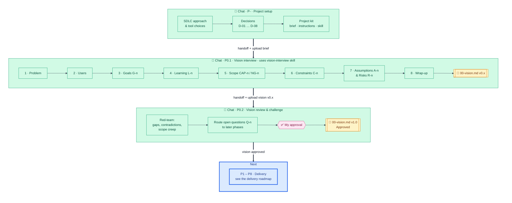

# FitCadence – Discovery roadmap

**Where I am now:** discovery (P0) is complete, vision v1.0 Approved · **Next:** delivery, starting with `P1.1 · Setup`. See `fitcadence-delivery-roadmap.md`.

## Map

Each box with 💬 is a separate Claude.ai chat. Context moves between chats only through documents and handoff blocks, not chat history.

**Legend:** green = done · blue (thick border) = next · yellow = document produced · pink = my approval gate

## Status tracker

| Context                          | Type              | Status                        | Output                                                            | Version                |
| -------------------------------- | ----------------- | ----------------------------- | ----------------------------------------------------------------- | ---------------------- |
| P- · Project setup               | 💬 Claude.ai chat | ✅ Done                       | Brief, Project instructions, vision-interview skill, this roadmap | BRIEF-001 v0.3         |
| P0.1 · Vision interview          | 💬 Claude.ai chat | ✅ Done (8 of 8 stages)       | `00-vision.md`; input: `Training_System_Spec.md`                  | vision v0.7, spec v0.4 |
| P0.2 · Vision review & challenge | 💬 Claude.ai chat | ✅ Done (approved 2026-11-03) | `00-vision.md` Approved                                           | vision v1.0            |
| P1 to P8 · Delivery              | ⌨️ and 💬         | ▶️ Next                       | See `fitcadence-delivery-roadmap.md`                              | ROAD-002 v0.1          |

## Status of this file

Frozen: P0 is complete. Update it only if discovery is reopened, for example a vision change that needs a new `P0.x` chat. Delivery tracking is in `fitcadence-delivery-roadmap.md`.

## Change log

- 1.1 (2026-11-03): Delivery split into its own roadmap (ROAD-002). The "Next" box now collapses P1 to P8 into one summary box. File marked complete and frozen. Removed the "how to keep this current" steps (no longer needed).
- 1.0 (2026-11-03): P0.2 done, vision v1.0 Approved. P1.1 active. Status tracker updated.
- 0.9 (2026-11-01): P0.1 done (all 8 interview stages green, vision v0.7). P0.2 active. Status tracker updated (brief v0.3, spec v0.4).
- 0.8 (2026-11-01): Interview stage 7 (Assumptions & Risks) marked done, stage 8 (Wrap-up) active. Status tracker updated (vision v0.6).
- 0.7 (2026-11-01): Interview stage 6 (Constraints) marked done, stage 7 (Assumptions & Risks) active. Status tracker updated (vision v0.5).
- 0.6 (2026-11-01): Interview stage 5 (Scope) marked done, stage 6 (Constraints) active. Status tracker updated (vision v0.4).
- 0.5 (2026-11-01): Interview stage 4 (Learning) marked done, stage 5 (Scope) active. Status tracker updated (vision v0.3).
- 0.4 (2026-11-01): Interview stage 3 (Goals) marked done, stage 4 (Learning) active. Status tracker and versions updated (brief v0.2, vision v0.2).
- 0.3 (2026-10-31): P0.1 in progress. Interview stages 1 (Problem) and 2 (Users) marked done, stage 3 (Goals) active. Status tracker updated.
- 0.2 (2026-10-31): Forced light theme and white canvas so the diagram stays readable in dark mode (VS Code, Claude.ai, GitHub).
- 0.1 (2026-10-31): Initial roadmap; Project setup done, P0.1 next.
